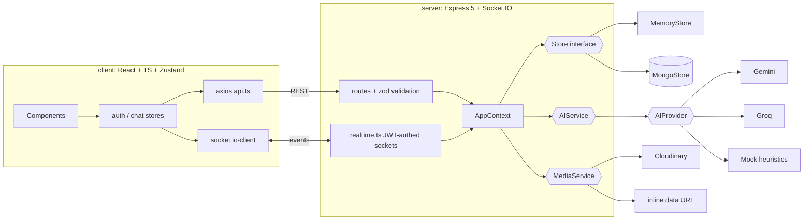

# CHANGES: QuickChat v1 → v2

Written so each change can be explained in an interview: **what**, **why**, **how**.

## Architecture in one minute

**Key idea: dependency injection through `AppContext`.** Routes never import a database, an LLM or socket.io directly; they receive `{store, ai, media, realtime}`. `index.ts` picks real implementations from env vars; tests pass fakes. That is why the app runs with zero keys and why 23 server tests run in 2 s without a database.

**Request flow (send a message):** `POST /api/messages/:id` → `requireAuth` (JWT → user) → zod validates body → `media.upload` for images → `store.createMessage` → `realtime.emitToUser(receiver, "message:new")` → response. The client had already shown the message optimistically and swaps in the real one.

## Changes, feature by feature

### 1. Zero-config demo mode
- **What:** `npm install && npm run dev` works with no accounts. Seeded demo user and bot contacts.
- **Why:** v1 couldn't run without Mongo + Cloudinary; reviewers bounce off that.
- **How:** `Store` and `MediaService` interfaces with in-memory/inline implementations; Mongo/Cloudinary chosen only when env vars exist; Mongo failure degrades to memory.

### 2. TypeScript + monorepo + tests
- **Why:** the v1 bugs (missing import, wrong option type, null deref) are exactly what a compiler catches.
- **How:** npm workspaces; strict TS; ESLint; Vitest (server: API integration via supertest + AI units; client: formatting and state-reducer units).

### 3. Security and correctness fixes
- Password hash no longer returned; unknown-email login no longer crashes; one generic "Invalid email or password".
- JWT expiry (7d); socket handshake verifies the JWT (v1 trusted `?userId=`).
- zod validation on all bodies; real HTTP status codes; central error handler that never leaks internals.
- helmet, CORS from env, rate limits on login and AI routes.
- Authorization: only the two participants can react to a message; image type/size validated.
- Multi-tab presence via per-user connection counts and socket rooms (v1 map kept only the last socket).
- `/chats` endpoint returns users + last message + unseen in one call (removes the N+1 and the refetch on each presence change).

### 4. AI features (Gemini / Groq / mock)
- **Smart replies:** three one-tap suggestions above the composer when the latest incoming message changes. Stale-response guard in the effect.
- **Summarize chat:** side panel button.
- **Tone rewrite:** wand button turns a draft friendlier / professional / concise / playful.
- **Bot contacts with personas:** Quick AI, Alison, Marco, Enrique reply with a typing delay.
- **Why this design:** `AIProvider.complete()` is the only LLM surface (~20 lines per vendor, raw `fetch`, 12 s timeout). `AIService` holds prompts and catches *every* failure → heuristics in `heuristics.ts`. Result: provider outage, bad JSON or 429s degrade quietly instead of breaking chat. Tested by injecting failing/junk providers.

### 5. Chat experience
- Typing indicators (throttled client emit, auto-stop timer), read receipts (✓ / ✓✓), emoji reactions (optimistic, rolled back on failure), recency-sorted chat list with previews and unread badges, day separators and message grouping, scroll-to-latest button, shared-media gallery, lightbox.
- **Optimistic sending** with `sending` → `failed` + retry state. Deduping (`appendUnique`) handles the race between HTTP response and socket event.
- After a socket reconnect the chat list resyncs.

### 6. UI redesign
- Dark aurora gradient canvas, glass panels, Bricolage Grotesque display type, pill controls, gradient bubbles. Inspired by the vibrant, minimal-chrome, media-forward feel of vibrant.design.
- Responsive: 3 columns ≥1280px, 2 columns ≥768px, single-screen navigation on phones, info drawer in between.
- Loading skeletons, empty states, error states with retry, `prefers-reduced-motion` support, labelled controls and `aria-live` log for screen readers.

### 7. Structure cleanup
- Context providers → two Zustand stores (`auth`, `chat`), with testable pure functions in `chatLogic.ts`.
- Server split into `routes/`, `services/`, `store/`, `ai/`; no circular imports (v1 controllers imported `io` from `server.ts`).
- Deleted unused assets and dead code.

## Interview cheat sheet
- *Why Zustand over Context?* Context re-renders all consumers on any change; Zustand selects slices and keeps logic outside components.
- *Why not Next.js?* Socket-driven SPA behind login: no SEO/SSR need, and Socket.IO needs a persistent server anyway.
- *How is realtime secured?* Socket handshake carries the same JWT; the server derives identity from it and joins a `user:<id>` room.
- *What if the LLM is down?* Provider throws → `AIService` catches → deterministic heuristics → UI unchanged.
- *What would you do next?* Pagination, Redis adapter for multi-instance Socket.IO, Mongo integration tests with `mongodb-memory-server`, E2E tests with Playwright.
