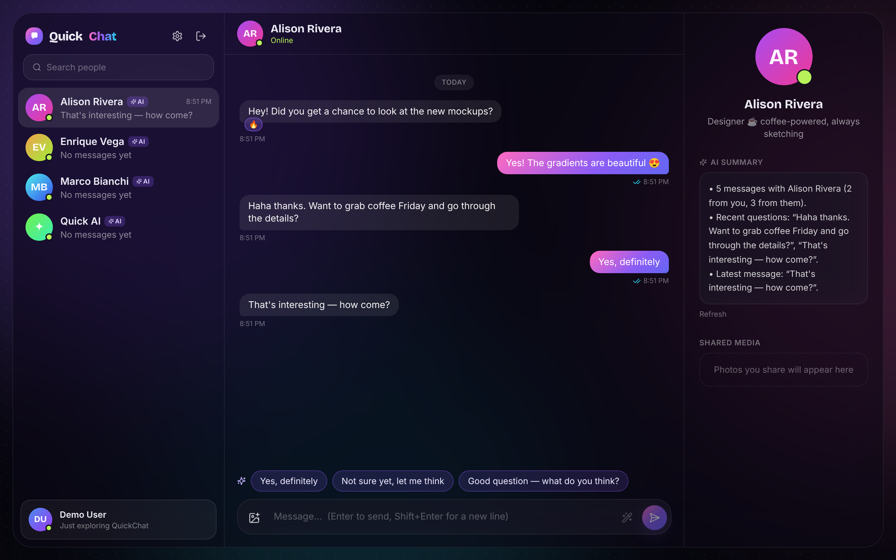
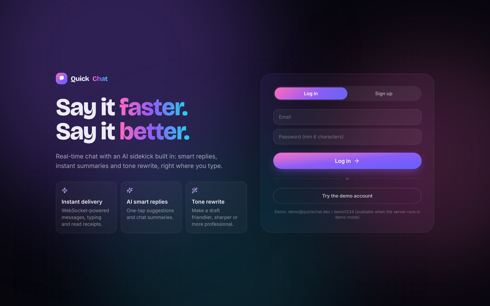
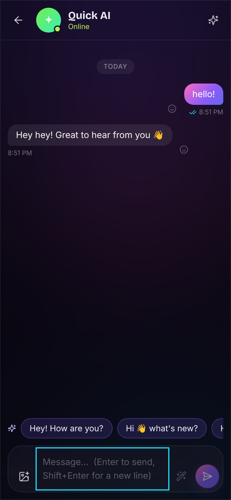
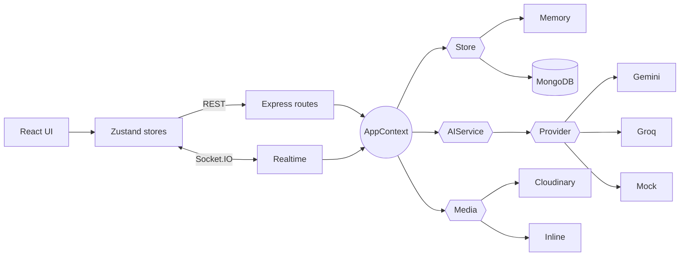

<div align="center">

# QuickChat

**Real-time chat with an AI sidekick: smart replies, instant summaries and tone rewrite, built in.**

React · TypeScript · Express · Socket.IO · MongoDB · Gemini/Groq



</div>

## Features

- ⚡ **Real-time messaging** over authenticated WebSockets, with typing indicators, online presence and ✓/✓✓ read receipts
- ✨ **AI smart replies**, **chat summaries** and **tone rewrite** (friendly / professional / concise / playful), powered by Gemini or Groq
- 🤖 **Persona bot contacts** (Quick AI, Alison, Marco, Enrique) so there is always someone to talk to
- 😀 Emoji reactions, image sharing with lightbox and media gallery, recency-sorted chats with unread badges
- 🛟 Optimistic sending with failed-state retry; skeleton, empty and error states everywhere
- 🔐 JWT auth, bcrypt, zod validation, helmet, rate limiting
- 📱 Responsive 3 → 2 → 1 column layout
- 🧪 **Runs with zero API keys**: in-memory store + mock AI. Add Mongo/Cloudinary/Gemini/Groq keys only when you want them.

| Sign in | Mobile |
|---|---|
|  |  |

## Tech stack

| Layer | Choice |
|---|---|
| Web | React 19, TypeScript, Vite, Tailwind CSS v4, Zustand, lucide-react |
| API | Node 22, Express 5, Socket.IO 4, zod, helmet |
| Data | MongoDB (Mongoose) or in-memory, behind a `Store` interface |
| AI | Gemini or Groq through a small `AIProvider` interface, with offline mock |
| Tests | Vitest, supertest (37 tests) |

## Architecture



Full explanation: [CHANGES.md](CHANGES.md). Audit, decisions, deployment: [developer.md](developer.md).

## Getting started

```bash
npm install
npm run dev
```

Open http://localhost:5173 and press **Try the demo account** (`demo@quickchat.dev` / `demo1234`).

Optional configuration lives in `server/.env` (see `server/.env.example`): `MONGODB_URI`, `CLOUDINARY_*`, `GEMINI_API_KEY` or `GROQ_API_KEY`, `JWT_SECRET`. `GET /api/health` shows which modes are active.

```bash
npm run typecheck && npm run lint && npm test && npm run build
```

## Roadmap

- [ ] Message pagination / infinite scroll
- [ ] Edit and delete messages
- [ ] Group chats and contact requests
- [ ] Redis adapter for multi-instance Socket.IO
- [ ] Light theme, PWA and push notifications
- [ ] Mongo integration tests and Playwright E2E
